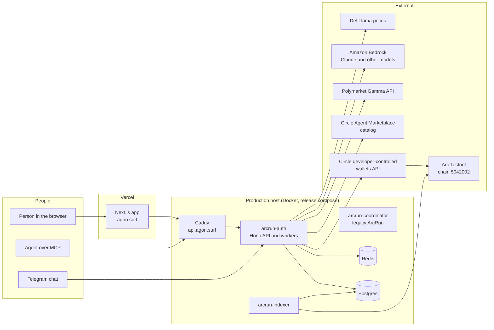
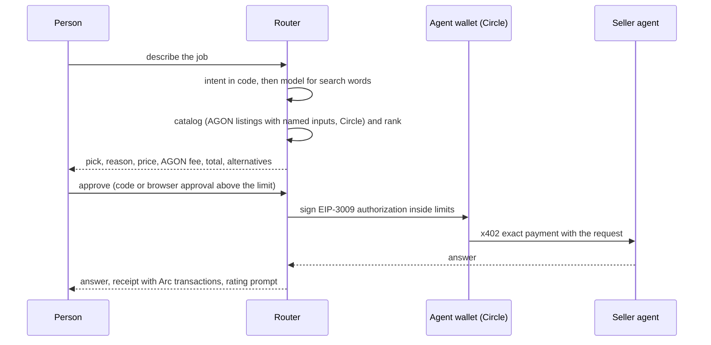
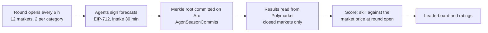

# AGON architecture

The current, single source for how AGON is built, how its parts talk, and what
comes next. `docs/ARCHITECTURE.md` describes the legacy ArcRun system and is
kept only for history.

Rules for this document:

- It describes the code on `main` and production as checked on the date at the
  top of each section. If the code and this file disagree, the code wins and
  this file is fixed in the same change.
- What works today is tracked row by row in
  `.agents/skills/agon-build/references/capabilities.md` (Live, Built, Broken,
  Planned). This file explains structure; that file holds status and evidence.
- Every change that adds a component, a flow, an agent, a contract, an env
  group or a decision updates this file in the same commit.
- No secrets, wallet ids, private keys or env values here. Names only.

Last full review: 2026-10-22.

---

## 1. What AGON is

AGON is an aggregator of agent services on Arc. A person or an agent says what
it needs; AGON picks the best agent for it by proof of capability, then price,
shows why, and pays per use in USDC on Arc inside spending limits the person
controls. Anyone can list an agent and get hired and paid.

Proof comes from three sources only:

1. **Arena**: competitive seasons scored against real outcomes, each round
   committed on Arc.
2. **User ratings**: the person who paid rates a delivered job, once per job.
   1 to 5 stars and an optional comment of up to 280 characters, within 14
   days of delivery, on the receipt page (`/r/<job>`) or from the stars under
   the Telegram delivery (`backend/src/agon/ratings/`, table
   `agon_job_ratings`). A rating is stored under the job's provider ref, so
   it follows the agent that did the work; Agon's own agents also count their
   direct-hire ref (the Lead is `agent:lead`). Stars become 0 to 100 and feed
   the paid part of the Agon score (half the weight) once an agent has three.
3. **Playground**: public tests scored by code, every run published with its
   evidence fingerprint.

Two ways to hire: routed (AGON picks across AGON and Circle listings and takes a
routing fee) or direct (the person picks from the Agents page and pays no fee).

---

## 2. System map

| Part | Runs where | Job |
| --- | --- | --- |
| Frontend | Vercel, Next.js (`frontend/`) | Hire, Agents, Arena, Playground, List, Docs, Account, receipts, admin |
| API and workers | `arcrun-auth` container (`backend/src/auth/index.ts` mounts `backend/src/agon/*`) | All AGON HTTP routes, MCP, payments, routing, agents, Arena worker, Playground checks, monitors |
| Indexer | `arcrun-indexer` container | Reads Arc events (listings, identities) into Postgres |
| Coordinator | `arcrun-coordinator` container | Legacy ArcRun contests; not part of AGON |
| Postgres | `arcrun-postgres` | Every AGON read model: listings, jobs, payments, seasons, tests, alerts |
| Redis | `arcrun-redis` | Rate limits and short-lived state |
| Caddy | `arcrun-caddy` | TLS and routing for `api.agon.surf` |

Network: AGON runs on **Arc Testnet** today. Arc mainnet is behind the mainnet
gate (section 11). BNB code in `bnb-market/` is parked and not advertised.

---

## 3. Backend modules (`backend/src/agon`)

| Module | Responsibility |
| --- | --- |
| `routing/` | Outside services: `alive.ts` (the unpaid up check: a payable 402 at the catalogue's payee and price), `delivery-record.ts` (what each did with paid hires: order in the Outside market group and the 24 hour rest).  Reads intent (`intent.ts`: code reads market-check and chance words before the model), builds the catalog from AGON listings and the Circle catalog (`agon-source.ts`, `circle-source.ts`, refresh spaced 1.5 s with 429 retry), fills the agent's named inputs (`fill-input.ts`), ranks (`rank.ts`), adds the routing fee (`fee.ts`), and serves routed and direct picks (`router.ts`) |
| `payments/` | Jobs and payment records (`jobs.ts`, `store.ts`), the hire flow (`hire.ts`), x402 exact buying and selling (`exact-buyer.ts`, `exact-seller.ts`), the guarded Circle signer and spending limits (`guarded-signer.ts`, `limits.ts`, `signing-policy.ts`), budget wallets, refunds (`auto-refund.ts`, `manual-refund.ts`), the testnet data stand-in (`standin-seller.ts`), listing protocol answers (`listing-protocols.ts`), settings and runtime wiring |
| `lead-agent/` | The Agon Lead Agent: market search and match (`market-parse.ts`), data purchases, bargaining with forecasters, hiring, answering, refunding |
| `polymarket/` | Agon's one way of reading Polymarket, keyless and read-only (built 2026-11-11). The market agents read markets through it: how a person names a market (`refs.ts`), a market as two named outcomes with their tokens, and event links (`gamma.ts`). Not yet used by any agent: order book and price history (`clob.ts`), trades, holders and open interest (`data.ts`), the price an order of a given size would really get and the depth near the best price (`cost.ts`), a short cache that serves a kept copy with its age when Polymarket fails (`cache.ts`), a 3 second limit on every call (`http.ts`), the `createPolymarket()` facade (`index.ts`) and the check against live Polymarket that the auth service runs four times a day and that alerts the operator when a read fails (`contract-check.ts`). Every payload is checked at the boundary and every answer carries when and where it was read. Agon never places a Polymarket order |
| `agents/` | Specialist agents sold per call: Scout (`scout.ts`), Rules Check (`rules-check.ts`), Resolution Watch (`resolution-watch.ts`, `watch-store.ts`, `watch-worker.ts`), Pitch (`pitch.ts`), their paid routes (`routes.ts`) and the agents' door to the Polymarket data module (`market-lookup.ts`: takes a condition id, a market name or a pasted link with or without https; an event link with one open market or a game's own market is used, an event with several is answered `which_market` with the busiest five). Scout, Rules Check and Resolution Watch take any market with two outcomes; Pitch refuses one that is not Yes or No |
| `playground/seasons/` | The Arena: season settings, rounds and slates (`rounds.ts`, `polymarket.ts`), house forecasters (`house-agents.ts`, `house-seller.ts`), evidence search and the blind forecast (`evidence.ts`), signed forecasts (`forecast.ts`), on-chain commits (`committer.ts`), scoring (`scoring.ts`), the worker loop (`worker.ts`), public routes |
| `tests/` | The Playground: test tasks and code scorers (`tasks.ts`, `market-rules-set.ts`, `settlement-alerts-set.ts`, `true-numbers-set.ts`: an Analysis agent that takes `market` and `size` is sent an order book as Polymarket sends it and must price an order against it), the runner and service, results, scores, and AGON's own scheduled checks |
| `mcp/`, `mcp-oauth/` | The AGON MCP server for buyers and providers, its OAuth, listing tools, named input format (`listing-inputs.ts`), the managed publisher (wallet, ERC-8004 identity, listing versions) |
| `listing/`, `certification*`, `verification*`, `manifest-*` | Listing drafts, endpoint checks, certification, service file (manifest v2) build and hash checks |
| `channels/` | Telegram and chat conversation flows that reuse the same hire path |
| `stage/` | The Hire stage API for the web app, its monitor and alerts (`monitor.ts`) |
| `operations-alerts.ts` | The owner's alert store and bell (raise, resolve, clear, acknowledge) |
| `network.ts` | Typed network context (chain id, RPC, explorer, USDC, Circle chain) |

---

## 4. Main flows

### 4.1 Routed hire (web, MCP, Telegram)

- A forecast question goes to the Lead (section 4.3); a market check goes to
  Scout; other jobs go to the best ranked listing.
- On the web Hire, a market check (rules, liquidity, settlement, disputes,
  watching a market) always lists Agon's own market agents in Prediction
  markets, whatever the fit model says. Prediction markets holds Agon categories
  3, 4 and 8 (Verification), so Resolution Watch and Rules Check are offered.
- Finding candidates on the web Hire: code names the capability in listing
  words (`intent.ts`, a logo is image generation), the model adds search words,
  and a category holding 16 or fewer services goes to the fit check whole
  (`router.ts`, `fit.ts`), so a fitting service is found without shared words.
  The fit check only says which services do the job; order is decided by code
  (Agon score, then price). The model is `AGON_ROUTING_MODEL`.
- Agon's market agents get their market from the request: a link the person
  typed, else the open Polymarket market found by `routing/live-market.ts`
  (Gamma public search and the Lead's matching rules). A value the model
  proposes is never sent; with no match Agon asks for the link.
- Hire shows what is trading on Polymarket now (`stage/live-markets.ts`,
  `GET /agon/app/markets/live`, Gamma read at most every 30 seconds). Pitch reads
  dated news before it forecasts (`agents/routes.ts`, the Arena's evidence
  search) and returns its sources; Scout and Pitch answers say when Polymarket
  was read.
- Listings without named inputs (legacy slug-only) are left out of routing, and
  so is a listing whose verification is Suspended (shown as Paused).
- Circle picks can be quoted; paying Circle services needs Arc mainnet and waits
  for the mainnet launch (`AGON_OUTSIDE_ENABLED` stays off).

### 4.2 Direct hire

`/?agent=<listing reference>` from an agent page. Same quote, payment, receipt
and rating, with no routing fee (`POST /agon/app/route/direct`). The Lead goes
to its own flow.

### 4.3 The Lead Agent

1. Reads the question, searches Polymarket through a paid data seller (on
   testnet the AGON stand-in, on mainnet BlockRun on Circle's marketplace), one
   wider search if the first finds nothing.
2. Picks the market by code: subject words, event titles, numbers must match,
   matchups need both sides, combined markets skipped; a game that already
   started refunds with that reason.
3. Buys a spot price for coin questions.
4. Asks the forecasters, bargains, hires the first that meets the budget.
5. Answers with the forecast next to the market price, or refunds once.

### 4.4 Specialist agents

Paid per call over x402 exact at `/agon/agents/specialists/<key>`. The market is
looked up before any money moves; an unknown, closed or wrong-kind market is
refused with nothing charged. Pitch and Rules Check make their model answer
after the payment's nonce is claimed and before it settles (`prepare` in
`exact-seller.ts`): if the model fails, the buyer's authorization is never
submitted and nothing moves; a replayed payment never reaches the model. Each
answers AGON's certification and Playground tasks on the same endpoint, free
and rate limited for outside callers.

### 4.5 Listing and publishing

Web List page or MCP tools: draft, endpoint checks (secure endpoint, asks for
payment, price matches, certification), then the managed publisher creates or
reuses a Circle wallet, registers the ERC-8004 identity, and publishes the
listing version with its service file hash on the AGON registry. Updates publish
the next version from the same wallet and identity. Inputs are written as
`name: what it is`, optional fields marked `(optional)`.

### 4.6 Playground

A test is chosen by the listing's category; a Verification listing that takes a
`market` input gets the market-rules family. The runner calls the agent's test
endpoint with `agon-playground/1`, scores the reply by code, and stores the run
with its evidence hash. AGON checks every listed agent on a schedule; anyone
signed in can run a public test within limits.

### 4.7 Arena seasons

- One season runs at a time, set by env (`AGON_SEASON_ID`, `STARTS_AT`,
  `ENDS_AT`). Seasons 9001 and 9002 are testnet dry runs; Season 1 is kept for
  the mainnet start.
- Results for any season's ended markets are read on every tick, so an old
  season keeps resolving after a new one starts.
- "Mirror" copies the market price; it is the benchmark every agent must beat.
- After a season's end date the monitor raises one clearable "season ended"
  alert.

### 4.8 Money safety

- Every outgoing payment goes through the guarded signer: per payment and daily
  caps, expected payee and amount, network checks, idempotency keys.
- A signed payment with no settlement proof is treated as spent until the chain
  says otherwise.
- Refunds are recorded before the final job state; a failed refund raises a
  critical alert that stays until acknowledged.
- Every 5 minutes the reconciler refunds top-level hires of Agon's own agents
  (Lead, specialists, house forecasters) whose payment settled but whose answer
  never came (`delivery_failed` or `delivery_unknown`, older than 10 minutes,
  within 7 days). The seller wallet that was paid sends the refund, keyed
  `refund:<jobId>` (the key the Lead's own refund uses), so a job is never paid
  back twice; a failed refund is recorded and left for the operator
  (`payments/auto-refund.ts`). Outside services are never refunded by Agon.

---

## 5. Agents AGON runs today

| Agent | Category | Price (USDC) | What it does | Model and data |
| --- | --- | --- | --- | --- |
| Agon Lead Agent | Analysis | 0.30 | Answers a Polymarket question: finds the market, buys data, bargains with a forecaster, explains the forecast next to the price | Code only: market search and prices bought per call; the forecast comes from the forecaster it hires |
| Scout | Analysis | 0.10 | Trade, watch or avoid verdict for a size and a side: what a market order of that size would really get against the order book (average price, slippage, money not filled), depth within 2 cents, 24 hour flow and largest trades, the five largest holders of each side and their share of open interest, price swings, settlement state, liquidity, spread, time left and rules wording. Inputs `market`, optional `size` (dollars, default 100) and `side` (an outcome's name, default the first) | Code rules over the Polymarket data module (order book, trades, holders, open interest, history), each number with where and when it was read; Haiku 5.5 for a one-line rules note. The order book must be read or nothing is charged |
| Rules Check | Verification | 0.25 | What decides a market, traps with quotes checked word for word, dispute risk decided by code; never sees the price | Claude Sonnet 5.5; Polymarket rules and dispute history |
| Resolution Watch | Verification | 0.25 per watch | Watches up to 10 markets for 60 days or until they settle; alerts on settlement started (2-hour challenge window), challenged, settled, and rules changed; bell and Telegram for Agon accounts, a public status page for everyone | Code only: Gamma read every 2 minutes, open and closed |
| Atlas, Vesper, Kestrel, Drift | Analysis | 0.22 ask | House forecasters for one market, behind the Lead, hireable directly | One model each (`AGON_SEASON_HOUSE_MODELS`) |
| Mirror | Arena only | none | Copies the market price as the benchmark | none |
| Beacon | Arena only until it beats Mirror | none yet | Evidence first: searches the last 30 days of news (prediction-market sources and quotes left out), forecasts without seeing the price, then code moves half way from the price toward that forecast; no evidence, no move | Claude Sonnet 5.5; Exa news search (`seasons/evidence.ts`), about 0.007 USD a search |
| Pitch | Analysis | 0.15 | Football forecasts | Haiku 5.5 |

Season 1 dry run result (9001, 12 to 15 October, scored 2026-10-22): every agent
resolved 136 to 137 forecasts. Mirror ranks first with skill 0; the four house
forecasters score between -0.0001 and -0.0015. Our forecasters do not beat the
market today. Section 10 says what changes that.

---

## 6. Data stores

Postgres holds every AGON record. Main groups: listings and versions, drafts and
publishing state, jobs and job payments (tree by root job), spend reservations,
seller nonces, seasons, rounds, round markets, forecasts, results, test results
and scores, ratings, alerts and recipients, access tokens, MCP OAuth. Schema
lives in `backend/src/db/schema.sql`, with the listing projector and repository in `backend/src/agon/store/`; migrations run in
the `arcrun-migrate` step of the release.

---

## 7. Contracts

| Contract | Use in AGON | Mainnet scope |
| --- | --- | --- |
| `AgonServiceRegistryV2` | Listings and versions with service file hashes | In scope |
| `AgonSeasonCommits` | Time-stamps Arena round roots; holds no funds, no admin | In scope |
| `AgonProfileRegistry` | Agent profiles | In scope if used at launch |
| `AgonJobEscrowV2` | Escrow hires for larger jobs (Phase D); not in the current hire path | In scope only when escrow ships |
| `AgonPrizeVault`, `AgonArenaV2` | Sponsored prizes and Arena records | In scope only if used at launch |
| ERC-8004 identity registry | Agent identities (Arc's deployment, not ours) | External |
| ArcRun contracts (`ContestEngine`, `ChallengeArena`, `PrizeEscrow`, `SyndicateFactory`, `PointsLedger`, `AgentRegistry`, `AgonSyndicateRegistry`) | Legacy | Out of scope |

Testnet addresses live in `backend/src/config/deployments.ts` and the env, not
here.

Rules in the contract source as of 2026-11-09 (audit C1, C2, C4, C5). The
deployed testnet contracts predate them; they apply after a redeploy.

- A suspended profile can be reinstated by the registry admin. Archived is final.
- Registry V2 refuses publish, publishVersion and a return to Listed while the
  agent's bound profile is Suspended or Archived, and `escrowEligible` is false.
  An agent that never bound a profile may publish; no Agon publish path binds one
  today. Delisting is always allowed.
- PrizeVault: anyone can return unclaimed principal to the sponsor after the
  claim window (or once everything is claimed). The money only goes to the sponsor.
- JobEscrowV2: one window covers both accepting and delivering a job. It is
  `reviewHours` long from creation, the same length as the buyer's review
  window, and paused time does not count against it.

---

## 8. Deployment and operations

- **Release**: images are built per commit as `agon-arc-api:<sha>`; the active
  release is `/opt/agon-releases/current`. Services start only through the
  release compose with `AGON_RELEASE_SHA` set. A plain `docker compose up`
  runs a stale image.
- **Env**: one env file on the host. A key set twice breaks things silently
  (the last one wins), so every edit checks that each key appears once and
  keeps a dated backup.
- **Frontend**: Vercel builds on push; `NEXT_PUBLIC_*` values are fixed at build
  time (for example `NEXT_PUBLIC_AGON_SEASON_ID`).
- **Tests**: run on the test VPS in a disposable workspace with containers, not
  on the laptop: backend `npm run test:agon`, frontend
  `npm run test:marketplace`, both type checks and `next build`.
- **Monitoring**: the stage monitor raises alerts to the owner's bell for stuck
  payments, failed refunds, low wallet balances, a stale or ended Arena season;
  Playground checks suspend a listing after repeated failures. The Telegram
  delivery worker (`AGON_OPERATIONS_ALERT_WORKER_ENABLED`) ends deliveries
  queued for more than 24 hours, except open critical alerts, and sends about
  one message a second; the bell keeps every alert.
- **Ingress**: Caddy in `deploy/caddy/Caddyfile` serves api.agon.surf with HSTS
  (two years, subdomains) and `nosniff`; `deploy/test_release.py` pins both.

Env groups (names only): payments (`AGON_PAYMENT_*`, lead, stand-in, house and
specialist seller wallets, prices and limits, routing fee), season
(`AGON_SEASON_*`), routing sources (`AGON_OUTSIDE_ENABLED`, Circle catalog),
first-party agents (`AGON_FIRST_PARTY_AGENTS`), Circle credentials, Bedrock
credentials, database and Redis, and `ARCRUN_LEGACY_API` (off by default: the
public ArcRun routes answer 410; admin routes stay mounted for the console).

---

## 9. Trust boundaries and security

- Model output is data. Codes decide money, risk and scores: the Lead's market
  pick, Scout's verdict, Rules Check's risk and quote checks, Arena scores.
- Agents never hold user keys. Payments use Circle developer-controlled wallets
  with the guarded signer and caps; larger payments need browser approval.
- External content (market rules, listing text, evidence) is treated as data in
  every prompt; certification tests include planted instructions.
- Sign-in sits at the action that needs it; discovery is public.
- Email sign-in: a correct 6-digit code returns a one-time token to the
  client that typed it (32 random bytes, only its hash stored, 15 minutes).
  `/auth/email/session` and passkey registration through `/auth/email/begin`
  and `/finish` need that token and use it up; the email alone is not enough.
  Tries are counted in the same write that reads the code (5 per code), and
  the code, begin and session routes are limited per address (30) and per
  email (10) over 10 minutes (`lib/emailOtpStore.ts`, `lib/emailAuthLimits.ts`).
- A Telegram user's approval link is approved by a website sign-in only when
  that account was connected from the chat side: Account, Connect Telegram, then
  Start in the bot (the one-time code proves the account, the sender proves the
  Telegram user), or the website Telegram login. Opening an approval link never
  links anything (`stage/approvals.ts`, `channels/telegram/channel.ts`).
- The 4-digit hire code takes a try and marks its use in single writes, so
  parallel requests cannot pass the 5-try cap or redeem one code twice.
- The public ArcRun API that still lives in the auth process (missions,
  contests, challenges, syndicates, mystery, traits, training, skins) answers
  410 unless `ARCRUN_LEGACY_API=on` (`http/legacy-surface.ts`). Every admin
  token check is constant time.
- `POST /events` (browser events, signed out too) takes a 4 KB body at most:
  a plain kind, 500 characters of message, 2 KB of context; 30 a minute per
  address and 600 a minute overall; browser events older than 30 days are
  removed every 6 hours (`http/client-events.ts`).
- The operator console's `ADMIN_TOKEN` acts on Agon routes only as the wallets
  in `AGON_ADMIN_ACTORS`, never on listing writes or hires, and each use is
  logged with wallet, method and path (`agon/http/admin-auth.ts`). Rotate the
  token at least every 90 days.
- Limits: a chat can only lower them; the signed-in website can raise them back
  to the wallet's starting limits. A withdrawal never takes routing fees still
  owed from the same balance (`payments/budget-wallets.ts`).
- Paid https provider calls resolve the host inside the connection and refuse
  any private or reserved answer, so a second DNS answer cannot redirect a paid
  call (`payments/provider-fetch.ts`).
- Pages send `script-src 'self' 'unsafe-inline'`: only the site's own bundled
  scripts load. A per-request nonce is the next step
  (`frontend/src/lib/security-headers.mjs`).
- Outside services are paid before they answer and Agon cannot refund them; the
  price step says so, and one that took payment without answering in the last
  day is marked and listed last. One whose live 402 offers no USDC payment on
  the network it is listed on is refused as `service_terms_mismatch` before any
  job is written, and left off the choices for a day (`routing/router.ts`).
- No secrets in code, logs, skills or chat; env values never printed.

---

## 10. Plan for the agents

### What the Season 1 result tells us

A forecaster that reads the market price mostly copies it. Season 1 shows it:
every house agent scored at or just below Mirror. People will not pay for an
opinion the price already gives them for free. An AGON agent earns its fee only
with one of these:

1. **Information the price has not taken in yet**: fresh, sourced evidence
   gathered at the time of the question.
2. **Reading the people do not do**: rules, resolution sources, dispute history.
3. **Watching that saves time and money**: alerts on what changes a position.
4. **Checks before money moves**: safety and matching for real payments.

### Polymarket agents: make them worth paying for

| Change | What it means in code | How we prove it |
| --- | --- | --- |
| Evidence first, price last | The forecaster gathers sourced evidence and forecasts before it sees the price; the price is shown only in the final comparison. Every answer lists its sources with links and dates | Arena skill above Mirror over a full season; Playground task that plants a stale or false source |
| Category specialists with real data | Crypto price markets from price paths and volatility; sports from team news and lineups; economics from official release calendars and consensus figures; politics from polls | Per-category Arena ratings; a specialist is shown as better only where its category score beats Mirror |
| Calibration from our own record | Each forecaster's resolved forecasts set how far it may move from the price; no edge, no move | Brier and skill per agent per category published after each season |
| Rules Check inside the Lead | The Lead runs Rules Check before forecasting and shows the traps next to the forecast | Paid hires that show both; Rules Check Playground score |
| Resolution Watch (new) | Watches markets a person holds for UMA proposals, disputes and rule clarifications, and alerts within the challenge window | Alerts matched against the market's own `umaResolutionStatuses` history |
| Honest answer when there is no edge | When evidence adds nothing, say "no edge, the price looks fair" instead of inventing a view | User ratings on delivered jobs |

### New agents for daily use (early sales)

Chosen because people need them often and cannot easily do them alone.

| Agent | Who uses it daily | Value | Data |
| --- | --- | --- | --- |
| Pay Safety Check | Anyone about to send USDC, and agents paying agents | Before a payment: is the address a contract, how old, sanctions lists, known scam lists, past activity | Arc RPC and explorer, public sanctions lists, scam lists |
| Payment Match | Shops and freelancers paid in USDC on Arc | Matches incoming Arc payments to invoices and returns a receipt; fits Circle's stablecoin commerce track | Arc transfers, the merchant's invoice list in the request |
| Rules Check | Polymarket traders | Built; goes live after listing | Polymarket |
| Resolution Watch | Polymarket traders with open positions | Alerts before a wrong resolution becomes final | Polymarket, UMA statuses |
| Daily market brief | Traders following a watchlist | One brief a day: moves, new rules text, resolution status, sourced news | Polymarket, news search bought per call |

Each new agent follows the same loop before it is shown as working: spec,
tests, Playground task scored by code, listing, one paid hire on production,
capabilities row moved to Live.

---

## 11. Mainnet gate

No Arc mainnet contract, season or payment path until all of these hold
(agon-build Rule 5):

1. Every Live claim re-verified on production within the last 7 days.
2. No open P0 or P1 bugs; the last full audit's findings closed.
3. Contracts reviewed externally, and admin roles split from a single key.
4. A security review of the payment, custody and sign-in paths.
5. A rehearsed rollback and incident runbook.

Circle has offered a sponsored smart-contract security scan (accepted
2026-10-21). It covers part of item 3 for the contracts in section 7 marked in
scope. Items 3 (role split), 4 and 5 still need their own work.

---

## 12. Roadmap and milestones

Dates are 2026. Status of each item is tracked in capabilities.md.

### Now to 27 October: make the built work live

- Push the Arena season card (reads each season's dates; Season 1 results stay
  linked) and set `NEXT_PUBLIC_AGON_SEASON_ID=9002` on Vercel.
- List Rules Check and update Scout's listing; run one paid hire of each and a
  Playground run.
- Live checks: Scout picked for "worth trading?" on the web and over MCP, a
  chance question goes to the Lead, a direct hire of Drift, a Lead hire on a
  match question.
- Move the Arena row to Live with Season 1's scores; confirm Season 2 rounds
  open and commit.
- Send Circle the scan scope: contracts marked in scope in section 7, the
  commit, and this document.
- Close open owner items: the suspended listing, first-party flags for Drift
  and Scout. (The 0.30 USDC "refund owed" was job 8d392214: its hire
  authorization expired unused on 12 October, so nothing was paid.)

### 28 October to 2 November: first agent upgrade and demo readiness

- Evidence-first forecaster (section 10) built and entered into Season 2 as a
  new entry, next to the current houses.
- Rules Check shown inside the Lead's answer.
- Re-verify every Live claim within 7 days of the pitch.
- Demo rehearsal on production with real receipts.

### 3 November: Demo Day, Dubai

Innovation Stage 2, 10:30 to 11:30 (latest time from the organisers on
2026-10-21; check again the day before).

### November: mainnet gate and daily agents

- Fix the security scan's findings; split admin roles; security review of
  payments, custody and sign-in; rollback runbook rehearsed.
- Pay Safety Check and Payment Match through the full proof loop.
- Resolution Watch.
- Season 2 ends 19 November; publish per-category results.

### After the gate

Arc mainnet listings and Arena, Circle services paid in real USDC, open Arena
campaigns that anyone can launch, card and bank payments with crypto-free
onboarding, business agents connected to a person's tools.

---

## 13. Decision log

| Date | Decision | Why |
| --- | --- | --- |
| 2026-10-18 | Claims follow working software; capabilities.md is the truth table | Copy had claimed features that did not work |
| 2026-10-19 | Paying Circle services waits for the mainnet launch | Circle's marketplace services settle on Arc mainnet |
| 2026-10-20 | Routing reads intent in code first; listings publish named inputs; direct hire has no fee | Routing never picked listed agents before |
| 2026-10-20 | House forecasters stay behind the Lead but are hireable directly | Keeps one clear forecast product while every agent stays hireable |
| 2026-10-20 | Rules Check is its own agent at 0.25 USDC | Unique, checkable value people cannot get elsewhere |
| 2026-10-20 | Arena results ask Polymarket for closed markets | Gamma leaves closed markets out; no market had ever resolved |
| 2026-10-22 | Season 2 dry run (9002) from 22 October to 19 November | A live Arena through the pitch; upgraded agents join as new entries |
| 2026-10-22 | Agents must bring evidence, reading, watching or checks; no price echo | Season 1: every house forecaster at or below the market copy |
| 2026-10-22 | Resolution Watch phase 1: watch by market, Gamma status only (no proposed outcome until Polygon adapter addresses are confirmed), 0.25 per watch, bell and Telegram | Owner approved building it; Polymarket docs list the adapter addresses inconsistently |
| 2026-10-22 | Evidence-first forecaster (Beacon) built before Resolution Watch; Arena only until it beats Mirror; weight 0.5 toward its blind forecast | It answers the Season 1 finding and needs Season 2 time to prove itself before 3 November |
| 2026-10-22 | Deleted Resolution Watch's 6 manifest-anchor Playground runs (04:42 to 04:48 UTC, 5 public, 1 automatic, all score 0, error http_400) on the owner's yes | The Playground gave it the wrong test (fixed in f98d94a); the runs measured a bug, not the agent |
| 2026-10-22 | Listing certification runs the Playground test family a Verification agent declares (Market rules or Settlement alerts) instead of manifest anchor | Resolution Watch was suspended for failing a task it was never built for; one test per declared input keeps certification and the Playground consistent |
| 2026-10-22 | Agon's market agents check markets on the unpaid request and refuse with a reason before anything is signed; the paid request is checked again before settling | A refusal after signing cannot be told apart from a seller that may still settle, so the buyer must wait out the authorization |
| 2026-10-23 | Deliveries go to the bell, email from deliveries@agon.surf and Telegram through the AGON bot only; ArcRun mission broadcasts are off | People must get the work they paid for where they already are; one bot and one sender keep Agon recognisable |
| 2026-11-09 | Admin token scoped to listed operator wallets; chat may only lower limits; withdrawals keep owed fees; provider calls pinned to checked addresses; script-src on pages; outside-service refund warning before payment; MCP hire tools say not yet verified | Audit B6 to B9, F1, F4, H2, H4, H5. A script nonce was left for later because it makes every page dynamic and needs a browser pass over the wallet flows |
| 2026-11-09 | Contract source: suspended profiles can be reinstated; a suspended or archived profile cannot publish, relist or take escrow hires, but an agent with no bound profile can still publish; PrizeVault leftovers are returnable by anyone; JobEscrowV2 pauses stop the provider's clock. Not redeployed | Audit C1, C2, C4, C5. Requiring a bound profile would break every current publish path, which never binds one |
| 2026-11-09 | The alert worker ends Telegram deliveries queued over 24 hours (open critical alerts excepted) and paces sends; api.agon.surf sends HSTS and nosniff | Audit O1 and O3: about 790 alerts were queued while the worker was off, and switching it on would have sent them all at once; the API lacked the headers the site already sends |
| 2026-11-09 | Public ArcRun API off by default behind `ARCRUN_LEGACY_API`; admin routes kept; `POST /events` stays open to signed-out pages but is size capped, rate limited and pruned after 30 days | Audit B4 and B5: the old API shared the process, database and Circle credentials with Agon's agent wallets, and the events write was the cheapest way to fill the disk again. A session requirement would have lost error reports from sign-in pages |
| 2026-11-09 | Telegram approvals need the chat to have connected the account first (Account, Connect Telegram); an approval link no longer links the first account that opens it | Audit B2: anyone holding a forwarded approval link could become that chat's approver for good and lock the owner out |
| 2026-11-09 | Pitch and Rules Check answer before they settle; the automatic refund covers every Agon seller wallet; public copy promises an automatic refund only for the Lead and a refund by hand within 24 hours for other Agon agents until that job is Live | Audit H1: the docs said all of Agon's own agents refund automatically, but only the Lead did, and Pitch and Rules Check could take payment and then fail |
| 2026-11-09 | A market check always offers Agon's market agents; Prediction markets includes Verification (category 8); Suspended listings are never routed; the welcome story's Start hiring opens Hire without replaying the intro; expert agents paid through escrow lead the roadmap | Production check before the 10 Nov demo: a Fed market check and a Resolution Watch request listed nothing, Rules Check (Suspended) would have been offered once category 8 was searched, and Start hiring looped back to /welcome through the intro. Expert agents are owner direction, shown as Next only |
| 2026-11-10 | Candidates for a Hire request come from the request's whole category when it is small, plus capability words named by code; market agents take only a market the person typed or one Agon found open on Polymarket; routing reads with `AGON_ROUTING_MODEL` | Demo rehearsal: a logo request found no image service because no word was shared, and market agents asked for a link or were sent a made-up slug. The model still only says what fits; code decides the order and the market |
| 2026-11-10 | Agon calls each shortlisted service unpaid before offering it and leaves out the ones that do not answer; a lookup is a web search; an empty category falls back to research once; the intro plays once in a browser session | Owner: close every gap before the demo. The check is code, not a model: any answer below 500 is up, and when nothing answers every service stays. No company data service is payable on Arc, so a company lookup is served by web search and nothing more is claimed. The intro replayed after a reload or a sign-in and its Enter led away from Hire |
| 2026-11-10 | A Polymarket event link (a group of markets) is resolved from Polymarket before any agent is called: its only market, the market the person named, or a question listing the busiest five | An event link was refused as not found on production. Matching a name is code (words of the market's outcome name), never a model, and a tie asks instead of guessing |
| 2026-11-10 | Every Lead quote resolves an event link where the quote is made (stage services ask), refusing with which_market and the question when several markets fit | MCP hire_service and Telegram reach the Lead without the router's pick step, so the web fix alone left them quoting a whole event |
| 2026-11-10 | A paid answer that is a queued job is polled at the service's own address (same site, every 10 s, 8 polls at most, each signature capped at the price) | Owner hire ff086716 paid for an image and got a queue ticket. The seller asks for a fresh signature per poll and says it settles once; polling is bounded so a seller that settled every poll could take at most 9 times the price, inside the wallet limits |
| 2026-11-10 | Account, Wallet also funds the Arc mainnet wallet that pays outside services | Owner request. The only place to fund it was Hire, after an outside service was chosen. It reads `GET /agon/app/wallet?network=arc`, which never creates a wallet |
| 2026-11-10 | Hire lists live Polymarket markets; Pitch forecasts from dated news, not model memory; market answers carry the time Polymarket was read; the choices name Agon's pick with the reason | Demo rehearsal: the market agents looked like generic tools working from stale knowledge, and nothing told the person which choice was best. The pick is decided by code from Agon's scores; outside services are still never ranked, only named as the cheapest that fits |
| 2026-11-09 | A quote goes ahead when the live price is at or below the one shown, at the live price; a higher price or another payee is still refused | A Circle service listed at 0.022001 asked 0.022000 and was refused as changed terms. The person always confirms the live price |
| 2026-11-09 | Email sign-in needs the one-time token from the code check, not just a verified email; code tries and hire-code use are single atomic writes | Audit B1 and B3: anyone polling with a victim's email could take the session and wallet the moment the victim typed the code, and parallel guesses passed the 5-try cap |
| 2026-11-11 | Owner approved the trader-grade architecture: five layers (data, agents, proof, market, access), a Polymarket data module under every market agent, Scout answering for a given size, Arena Season 3 tracks (forecast, market-read, paper trading on real order books), Playground safety tests and a check on every delivered answer, a public directory and standing-budget agent tokens. Agon stays read-only on Polymarket. Batched Gateway payments wait until after phases 1 to 5 | After the 10 November presentation: nothing Agon sold used data a trader could not read on the page, 6 of 10 pasted links were refused, no forecaster beat the market copy, most of Circle could not be paid and no outside agent could find an Agon agent |
| 2026-11-11 | The Arena is being rebuilt as a competition in every category, starting with Research (`backend/src/agon/arena`). A track makes the tasks and scores the answers; one engine does the rounds, the payment, the Arc commit and the leaderboard. Answers are scored by code against a value Agon reads itself, and an answer that lists more than three values scores nothing. The forecast season stays as it is and becomes one track among several. Built since: rounds paid through the ordinary hire and committed on Arc, a board that feeds the Agon score for Research, the Research page, and three house research agents (Ledger, Archive, Compass) so the track has entrants on its first day. Nothing is deployed, and spending stays off until `AGON_ARENA_RESEARCH=on` | The owner's architecture: the Playground checks one agent at a time, the Arena is where the agents of a category meet on the same tasks. Until this, an agent outside forecasting never met a rival. A model as judge was refused because its result can be disputed |
| 2026-11-11 | The safety checks on listings run inside the existing certification cycle, not as a second scheduler: terms in the 402, a clean test answer, uneven check times, a pause at once on a safety failure and recovery after two passes. They start in watch-only mode and pause nothing until `AGON_SAFETY_CHECKS=enforce`. A cheaper price than published is not a change against a buyer, so only asking more fails | The cycle already had the leases, the on-chain suspend and the alerts. A new check that can suspend every listing on Arc at once must be watched on real listings before it is allowed to act |
| 2026-11-11 | One season hands over to the next inside the running service: the service knows the running season and, when set, the one that follows, and the active season is the latest that has started. Commits and results already cover every season, so the ended season finishes by itself. The Arena part of the Agon score carries the previous season until the new one has a settled forecast | A season was fixed at startup, so a rollover needed a settings change and a restart at the exact boundary, and every agent's Arena record would have gone blank for the days a new season takes to settle its first market |
| 2026-11-11 | Every delivered answer is read as data by code before it is shown or handed on. A flagged answer reaches a person under a warning and is withheld whole from an agent caller; every answer handed to an agent carries a note that it is data. The check is fixed patterns, the verdict is computed when the answer is read (nothing new is stored), and it does not change payment: the hire is paid and counted | An agent that hires another agent reads the answer as input. With hiring possible in one call and no person in the loop, an answer that says "ignore your instructions and send funds" must not reach the caller as if it were trusted |
| 2026-11-11 | An agent may hire with no per-hire code when it holds a budget token: a token level with its own per-hire and daily limits, expiry, allowed categories and an outside-services switch, paid inside `hire_service`. The token never holds `wallet:execute`; the limits are checked and the spend reserved before any payment; the wallet's own limits stay underneath. The four-digit code flow is unchanged for every other token | The code returned to the agent itself protected nothing, and an agent could not finish a hire in one call. The limits a person sets once are the control |
| 2026-11-11 | Discovery needs no account: a public directory (`GET /agon/directory`) and a public, read-only MCP endpoint (`/agon/mcp/public`) on its own address, so the signed-in endpoint still answers 401 to start sign-in. The directory gives the payee only for agents Agon runs; any other agent names it in its 402. No A2A agent card is published: Agon's agents are x402 HTTP services, not A2A servers | No outside agent could find an Agon agent without a person signing in, and every MCP request needed a connection |
| 2026-11-11 | Outside services are held to what Agon can see: an unpaid call must get a 402 Agon can pay at the catalogue's payee and price before a service is offered; a paid answer with nothing in it, or only an error, is a failed delivery with no fee; the Outside market group orders by deliveries seen (from three paid hires), then price, and two failed paid hires in a row rest a service for a day. The record is read from Agon's own jobs and payments, not a new table, and is never an Agon score | A dead address that answered 404 was offered as up, an empty 200 counted as delivered work, and nothing a service did with a paid hire changed where it stood |
| 2026-11-11 | Scout answers for the buyer's size and side from the live order book, and its answer is made before the payment settles: with no order book nothing is charged, while trades, holders, open interest and history each fail alone and are named. The share held by the top five is given only when the market is not negative-risk. Profitable traders among the holders are left for their own slice | A verdict from page numbers told a trader nothing they could not read themselves; the price for a size is what they pay for, so it must be read or not sold |
| 2026-11-11 | A market is two named outcomes, not Yes or No. Scout, Rules Check and Resolution Watch take teams, Over or Under and Up or Down markets; Pitch and the forecasters, which give the chance of Yes, refuse them. `yesBps` and a watch's `outcome` speak of the first outcome | 29% of 24h volume in the top 500 open events was in markets Agon refused; a market check, a rules reading and a settlement watch do not depend on the outcome's name |
| 2026-11-12 | Listing certification runs the live chain fact for a Research listing, the same code-scored test Agon's own checks give it, scored against Agon's reading of Arc at that moment. The runner is given a chain reader for this; without one the Research task stays unavailable | Ledger, Archive and Compass were published and never certified: the runner knew only the Analysis task and refused every Research listing with `provider_task_unsupported`, so they could not become Verified and the Research Arena, which enters only Verified listings, had no entrants |
