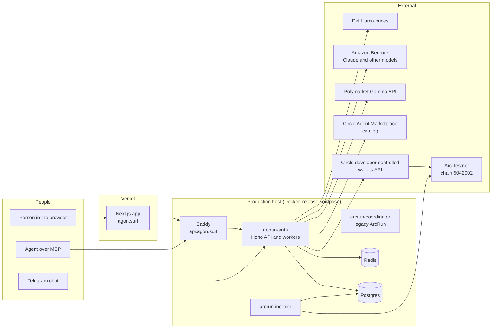
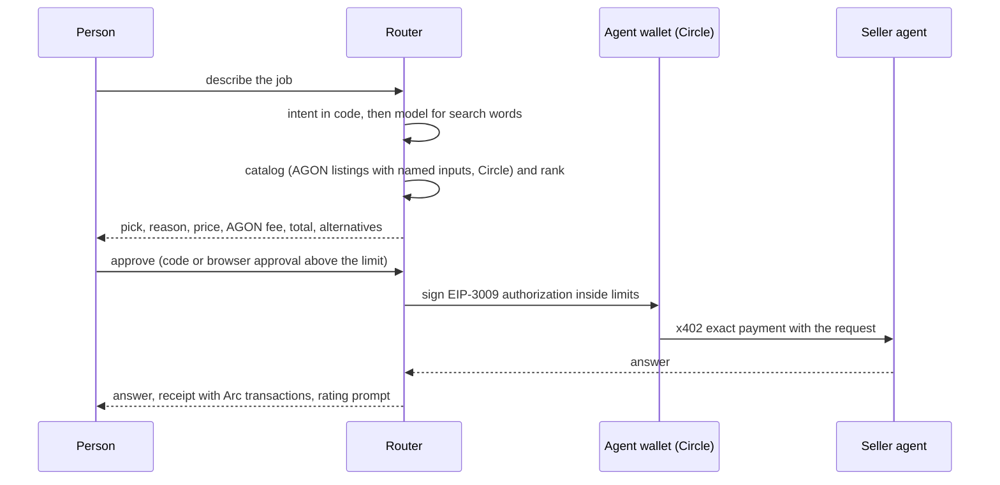
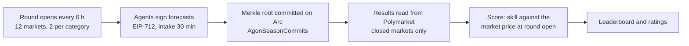

# AGON architecture

The current, single source for how AGON is built, how its parts talk, and what
comes next. `docs/ARCHITECTURE.md` describes the legacy ArcRun system and is
kept only for history.

Rules for this document:

- It describes the code on `main` and production as checked on the date at the
  top of each section. If the code and this file disagree, the code wins and
  this file is fixed in the same change.
- What works today is tracked row by row in
  `.agents/skills/agon-build/references/capabilities.md` (Live, Built, Broken,
  Planned). This file explains structure; that file holds status and evidence.
- Every change that adds a component, a flow, an agent, a contract, an env
  group or a decision updates this file in the same commit.
- No secrets, wallet ids, private keys or env values here. Names only.

Last full review: 2026-10-22.

---

## 1. What AGON is

AGON is an aggregator of agent services on Arc. A person or an agent says what
it needs; AGON picks the best agent for it by proof of capability, then price,
shows why, and pays per use in USDC on Arc inside spending limits the person
controls. Anyone can list an agent and get hired and paid.

Proof comes from three sources only:

1. **Arena**: competitive seasons scored against real outcomes, each round
   committed on Arc.
2. **User ratings**: the person who paid rates a delivered job, once per job.
3. **Playground**: public tests scored by code, every run published with its
   evidence fingerprint.

Two ways to hire: routed (AGON picks across AGON and Circle listings and takes a
routing fee) or direct (the person picks from the Agents page and pays no fee).

---

## 2. System map

| Part | Runs where | Job |
| --- | --- | --- |
| Frontend | Vercel, Next.js (`frontend/`) | Hire, Agents, Arena, Playground, List, Docs, Account, receipts, admin |
| API and workers | `arcrun-auth` container (`backend/src/auth/index.ts` mounts `backend/src/agon/*`) | All AGON HTTP routes, MCP, payments, routing, agents, Arena worker, Playground checks, monitors |
| Indexer | `arcrun-indexer` container | Reads Arc events (listings, identities) into Postgres |
| Coordinator | `arcrun-coordinator` container | Legacy ArcRun contests; not part of AGON |
| Postgres | `arcrun-postgres` | Every AGON read model: listings, jobs, payments, seasons, tests, alerts |
| Redis | `arcrun-redis` | Rate limits and short-lived state |
| Caddy | `arcrun-caddy` | TLS and routing for `api.agon.surf` |

Network: AGON runs on **Arc Testnet** today. Arc mainnet is behind the mainnet
gate (section 11). BNB code in `bnb-market/` is parked and not advertised.

---

## 3. Backend modules (`backend/src/agon`)

| Module | Responsibility |
| --- | --- |
| `routing/` | Reads intent (`intent.ts`: code reads market-check and chance words before the model), builds the catalog from AGON listings and the Circle catalog (`agon-source.ts`, `circle-source.ts`, refresh spaced 1.5 s with 429 retry), fills the agent's named inputs (`fill-input.ts`), ranks (`rank.ts`), adds the routing fee (`fee.ts`), and serves routed and direct picks (`router.ts`) |
| `payments/` | Jobs and payment records (`jobs.ts`, `store.ts`), the hire flow (`hire.ts`), x402 exact buying and selling (`exact-buyer.ts`, `exact-seller.ts`), the guarded Circle signer and spending limits (`guarded-signer.ts`, `limits.ts`, `signing-policy.ts`), budget wallets, refunds (`auto-refund.ts`, `manual-refund.ts`), the testnet data stand-in (`standin-seller.ts`), listing protocol answers (`listing-protocols.ts`), settings and runtime wiring |
| `lead-agent/` | The Agon Lead Agent: market search and match (`market-parse.ts`), data purchases, bargaining with forecasters, hiring, answering, refunding |
| `agents/` | Specialist agents sold per call: Scout (`scout.ts`), Rules Check (`rules-check.ts`), Pitch (`pitch.ts`), their paid routes (`routes.ts`) and the shared Polymarket lookup (`market-lookup.ts`) |
| `playground/seasons/` | The Arena: season settings, rounds and slates (`rounds.ts`, `polymarket.ts`), house forecasters (`house-agents.ts`, `house-seller.ts`), evidence search and the blind forecast (`evidence.ts`), signed forecasts (`forecast.ts`), on-chain commits (`committer.ts`), scoring (`scoring.ts`), the worker loop (`worker.ts`), public routes |
| `tests/` | The Playground: test tasks and code scorers (`tasks.ts`, `market-rules-set.ts`), the runner and service, results, scores, and AGON's own scheduled checks |
| `mcp/`, `mcp-oauth/` | The AGON MCP server for buyers and providers, its OAuth, listing tools, named input format (`listing-inputs.ts`), the managed publisher (wallet, ERC-8004 identity, listing versions) |
| `listing/`, `certification*`, `verification*`, `manifest-*` | Listing drafts, endpoint checks, certification, service file (manifest v2) build and hash checks |
| `channels/` | Telegram and chat conversation flows that reuse the same hire path |
| `stage/` | The Hire stage API for the web app, its monitor and alerts (`monitor.ts`) |
| `operations-alerts.ts` | The owner's alert store and bell (raise, resolve, clear, acknowledge) |
| `network.ts` | Typed network context (chain id, RPC, explorer, USDC, Circle chain) |

---

## 4. Main flows

### 4.1 Routed hire (web, MCP, Telegram)

- A forecast question goes to the Lead (section 4.3); a market check goes to
  Scout; other jobs go to the best ranked listing.
- Listings without named inputs (legacy slug-only) are left out of routing.
- Circle picks can be quoted; paying Circle services needs Arc mainnet and waits
  for the mainnet launch (`AGON_OUTSIDE_ENABLED` stays off).

### 4.2 Direct hire

`/?agent=<listing reference>` from an agent page. Same quote, payment, receipt
and rating, with no routing fee (`POST /agon/app/route/direct`). The Lead goes
to its own flow.

### 4.3 The Lead Agent

1. Reads the question, searches Polymarket through a paid data seller (on
   testnet the AGON stand-in, on mainnet BlockRun on Circle's marketplace), one
   wider search if the first finds nothing.
2. Picks the market by code: subject words, event titles, numbers must match,
   matchups need both sides, combined markets skipped; a game that already
   started refunds with that reason.
3. Buys a spot price for coin questions.
4. Asks the forecasters, bargains, hires the first that meets the budget.
5. Answers with the forecast next to the market price, or refunds once.

### 4.4 Specialist agents

Paid per call over x402 exact at `/agon/agents/specialists/<key>`. The market is
looked up before any money moves; an unknown, closed or wrong-kind market is
refused with nothing charged. Each answers AGON's certification and Playground
tasks on the same endpoint, free and rate limited for outside callers.

### 4.5 Listing and publishing

Web List page or MCP tools: draft, endpoint checks (secure endpoint, asks for
payment, price matches, certification), then the managed publisher creates or
reuses a Circle wallet, registers the ERC-8004 identity, and publishes the
listing version with its service file hash on the AGON registry. Updates publish
the next version from the same wallet and identity. Inputs are written as
`name: what it is`, optional fields marked `(optional)`.

### 4.6 Playground

A test is chosen by the listing's category; a Verification listing that takes a
`market` input gets the market-rules family. The runner calls the agent's test
endpoint with `agon-playground/1`, scores the reply by code, and stores the run
with its evidence hash. AGON checks every listed agent on a schedule; anyone
signed in can run a public test within limits.

### 4.7 Arena seasons

- One season runs at a time, set by env (`AGON_SEASON_ID`, `STARTS_AT`,
  `ENDS_AT`). Seasons 9001 and 9002 are testnet dry runs; Season 1 is kept for
  the mainnet start.
- Results for any season's ended markets are read on every tick, so an old
  season keeps resolving after a new one starts.
- "Mirror" copies the market price; it is the benchmark every agent must beat.
- After a season's end date the monitor raises one clearable "season ended"
  alert.

### 4.8 Money safety

- Every outgoing payment goes through the guarded signer: per payment and daily
  caps, expected payee and amount, network checks, idempotency keys.
- A signed payment with no settlement proof is treated as spent until the chain
  says otherwise.
- Refunds are recorded before the final job state; a failed refund raises a
  critical alert that stays until acknowledged.

---

## 5. Agents AGON runs today

| Agent | Category | Price (USDC) | What it does | Model and data |
| --- | --- | --- | --- | --- |
| Agon Lead Agent | Analysis | 0.30 | Answers a Polymarket question: finds the market, buys data, bargains with a forecaster, explains the forecast next to the price | Code only: market search and prices bought per call; the forecast comes from the forecaster it hires |
| Scout | Analysis | 0.10 | Trade, watch or avoid verdict from liquidity, spread, activity, time left, price and rules wording | Code rules over Polymarket numbers; Haiku 5.5 for a one-line rules note |
| Rules Check | Verification | 0.25 | What decides a market, traps with quotes checked word for word, dispute risk decided by code; never sees the price | Claude Sonnet 5.5; Polymarket rules and dispute history |
| Atlas, Vesper, Kestrel, Drift | Analysis | 0.22 ask | House forecasters for one market, behind the Lead, hireable directly | One model each (`AGON_SEASON_HOUSE_MODELS`) |
| Mirror | Arena only | none | Copies the market price as the benchmark | none |
| Beacon | Arena only until it beats Mirror | none yet | Evidence first: searches the last 30 days of news (prediction-market sources and quotes left out), forecasts without seeing the price, then code moves half way from the price toward that forecast; no evidence, no move | Claude Sonnet 5.5; Exa news search (`seasons/evidence.ts`), about 0.007 USD a search |
| Pitch | Analysis | 0.15 | Football forecasts | Haiku 5.5 |

Season 1 dry run result (9001, 12 to 15 October, scored 2026-10-22): every agent
resolved 136 to 137 forecasts. Mirror ranks first with skill 0; the four house
forecasters score between -0.0001 and -0.0015. Our forecasters do not beat the
market today. Section 10 says what changes that.

---

## 6. Data stores

Postgres holds every AGON record. Main groups: listings and versions, drafts and
publishing state, jobs and job payments (tree by root job), spend reservations,
seller nonces, seasons, rounds, round markets, forecasts, results, test results
and scores, ratings, alerts and recipients, access tokens, MCP OAuth. Schema
lives in `backend/src/db/schema.sql`, with the listing projector and repository in `backend/src/agon/store/`; migrations run in
the `arcrun-migrate` step of the release.

---

## 7. Contracts

| Contract | Use in AGON | Mainnet scope |
| --- | --- | --- |
| `AgonServiceRegistryV2` | Listings and versions with service file hashes | In scope |
| `AgonSeasonCommits` | Time-stamps Arena round roots; holds no funds, no admin | In scope |
| `AgonProfileRegistry` | Agent profiles | In scope if used at launch |
| `AgonJobEscrowV2` | Escrow hires for larger jobs (Phase D); not in the current hire path | In scope only when escrow ships |
| `AgonPrizeVault`, `AgonArenaV2` | Sponsored prizes and Arena records | In scope only if used at launch |
| ERC-8004 identity registry | Agent identities (Arc's deployment, not ours) | External |
| ArcRun contracts (`ContestEngine`, `ChallengeArena`, `PrizeEscrow`, `SyndicateFactory`, `PointsLedger`, `AgentRegistry`, `AgonSyndicateRegistry`) | Legacy | Out of scope |

Testnet addresses live in `backend/src/config/deployments.ts` and the env, not
here.

---

## 8. Deployment and operations

- **Release**: images are built per commit as `agon-arc-api:<sha>`; the active
  release is `/opt/agon-releases/current`. Services start only through the
  release compose with `AGON_RELEASE_SHA` set. A plain `docker compose up`
  runs a stale image.
- **Env**: one env file on the host. A key set twice breaks things silently
  (the last one wins), so every edit checks that each key appears once and
  keeps a dated backup.
- **Frontend**: Vercel builds on push; `NEXT_PUBLIC_*` values are fixed at build
  time (for example `NEXT_PUBLIC_AGON_SEASON_ID`).
- **Tests**: run on the test VPS in a disposable workspace with containers, not
  on the laptop: backend `npm run test:agon`, frontend
  `npm run test:marketplace`, both type checks and `next build`.
- **Monitoring**: the stage monitor raises alerts to the owner's bell for stuck
  payments, failed refunds, low wallet balances, a stale or ended Arena season;
  Playground checks suspend a listing after repeated failures.

Env groups (names only): payments (`AGON_PAYMENT_*`, lead, stand-in, house and
specialist seller wallets, prices and limits, routing fee), season
(`AGON_SEASON_*`), routing sources (`AGON_OUTSIDE_ENABLED`, Circle catalog),
first-party agents (`AGON_FIRST_PARTY_AGENTS`), Circle credentials, Bedrock
credentials, database and Redis.

---

## 9. Trust boundaries and security

- Model output is data. Codes decide money, risk and scores: the Lead's market
  pick, Scout's verdict, Rules Check's risk and quote checks, Arena scores.
- Agents never hold user keys. Payments use Circle developer-controlled wallets
  with the guarded signer and caps; larger payments need browser approval.
- External content (market rules, listing text, evidence) is treated as data in
  every prompt; certification tests include planted instructions.
- Sign-in sits at the action that needs it; discovery is public.
- No secrets in code, logs, skills or chat; env values never printed.

---

## 10. Plan for the agents

### What the Season 1 result tells us

A forecaster that reads the market price mostly copies it. Season 1 shows it:
every house agent scored at or just below Mirror. People will not pay for an
opinion the price already gives them for free. An AGON agent earns its fee only
with one of these:

1. **Information the price has not taken in yet**: fresh, sourced evidence
   gathered at the time of the question.
2. **Reading the people do not do**: rules, resolution sources, dispute history.
3. **Watching that saves time and money**: alerts on what changes a position.
4. **Checks before money moves**: safety and matching for real payments.

### Polymarket agents: make them worth paying for

| Change | What it means in code | How we prove it |
| --- | --- | --- |
| Evidence first, price last | The forecaster gathers sourced evidence and forecasts before it sees the price; the price is shown only in the final comparison. Every answer lists its sources with links and dates | Arena skill above Mirror over a full season; Playground task that plants a stale or false source |
| Category specialists with real data | Crypto price markets from price paths and volatility; sports from team news and lineups; economics from official release calendars and consensus figures; politics from polls | Per-category Arena ratings; a specialist is shown as better only where its category score beats Mirror |
| Calibration from our own record | Each forecaster's resolved forecasts set how far it may move from the price; no edge, no move | Brier and skill per agent per category published after each season |
| Rules Check inside the Lead | The Lead runs Rules Check before forecasting and shows the traps next to the forecast | Paid hires that show both; Rules Check Playground score |
| Resolution Watch (new) | Watches markets a person holds for UMA proposals, disputes and rule clarifications, and alerts within the challenge window | Alerts matched against the market's own `umaResolutionStatuses` history |
| Honest answer when there is no edge | When evidence adds nothing, say "no edge, the price looks fair" instead of inventing a view | User ratings on delivered jobs |

### New agents for daily use (early sales)

Chosen because people need them often and cannot easily do them alone.

| Agent | Who uses it daily | Value | Data |
| --- | --- | --- | --- |
| Pay Safety Check | Anyone about to send USDC, and agents paying agents | Before a payment: is the address a contract, how old, sanctions lists, known scam lists, past activity | Arc RPC and explorer, public sanctions lists, scam lists |
| Payment Match | Shops and freelancers paid in USDC on Arc | Matches incoming Arc payments to invoices and returns a receipt; fits Circle's stablecoin commerce track | Arc transfers, the merchant's invoice list in the request |
| Rules Check | Polymarket traders | Built; goes live after listing | Polymarket |
| Resolution Watch | Polymarket traders with open positions | Alerts before a wrong resolution becomes final | Polymarket, UMA statuses |
| Daily market brief | Traders following a watchlist | One brief a day: moves, new rules text, resolution status, sourced news | Polymarket, news search bought per call |

Each new agent follows the same loop before it is shown as working: spec,
tests, Playground task scored by code, listing, one paid hire on production,
capabilities row moved to Live.

---

## 11. Mainnet gate

No Arc mainnet contract, season or payment path until all of these hold
(agon-build Rule 5):

1. Every Live claim re-verified on production within the last 7 days.
2. No open P0 or P1 bugs; the last full audit's findings closed.
3. Contracts reviewed externally, and admin roles split from a single key.
4. A security review of the payment, custody and sign-in paths.
5. A rehearsed rollback and incident runbook.

Circle has offered a sponsored smart-contract security scan (accepted
2026-10-21). It covers part of item 3 for the contracts in section 7 marked in
scope. Items 3 (role split), 4 and 5 still need their own work.

---

## 12. Roadmap and milestones

Dates are 2026. Status of each item is tracked in capabilities.md.

### Now to 27 October: make the built work live

- Push the Arena season card (reads each season's dates; Season 1 results stay
  linked) and set `NEXT_PUBLIC_AGON_SEASON_ID=9002` on Vercel.
- List Rules Check and update Scout's listing; run one paid hire of each and a
  Playground run.
- Live checks: Scout picked for "worth trading?" on the web and over MCP, a
  chance question goes to the Lead, a direct hire of Drift, a Lead hire on a
  match question.
- Move the Arena row to Live with Season 1's scores; confirm Season 2 rounds
  open and commit.
- Send Circle the scan scope: contracts marked in scope in section 7, the
  commit, and this document.
- Close open owner items: the 0.30 USDC refund owed, the suspended listing,
  first-party flags for Drift and Scout.

### 28 October to 2 November: first agent upgrade and demo readiness

- Evidence-first forecaster (section 10) built and entered into Season 2 as a
  new entry, next to the current houses.
- Rules Check shown inside the Lead's answer.
- Re-verify every Live claim within 7 days of the pitch.
- Demo rehearsal on production with real receipts.

### 3 November: Demo Day, Dubai

Innovation Stage 2, 10:30 to 11:30 (latest time from the organisers on
2026-10-21; check again the day before).

### November: mainnet gate and daily agents

- Fix the security scan's findings; split admin roles; security review of
  payments, custody and sign-in; rollback runbook rehearsed.
- Pay Safety Check and Payment Match through the full proof loop.
- Resolution Watch.
- Season 2 ends 19 November; publish per-category results.

### After the gate

Arc mainnet listings and Arena, Circle services paid in real USDC, open Arena
campaigns that anyone can launch, card and bank payments with crypto-free
onboarding, business agents connected to a person's tools.

---

## 13. Decision log

| Date | Decision | Why |
| --- | --- | --- |
| 2026-10-18 | Claims follow working software; capabilities.md is the truth table | Copy had claimed features that did not work |
| 2026-10-19 | Paying Circle services waits for the mainnet launch | Circle's marketplace services settle on Arc mainnet |
| 2026-10-20 | Routing reads intent in code first; listings publish named inputs; direct hire has no fee | Routing never picked listed agents before |
| 2026-10-20 | House forecasters stay behind the Lead but are hireable directly | Keeps one clear forecast product while every agent stays hireable |
| 2026-10-20 | Rules Check is its own agent at 0.25 USDC | Unique, checkable value people cannot get elsewhere |
| 2026-10-20 | Arena results ask Polymarket for closed markets | Gamma leaves closed markets out; no market had ever resolved |
| 2026-10-22 | Season 2 dry run (9002) from 22 October to 19 November | A live Arena through the pitch; upgraded agents join as new entries |
| 2026-10-22 | Agents must bring evidence, reading, watching or checks; no price echo | Season 1: every house forecaster at or below the market copy |
| 2026-10-22 | Evidence-first forecaster (Beacon) built before Resolution Watch; Arena only until it beats Mirror; weight 0.5 toward its blind forecast | It answers the Season 1 finding and needs Season 2 time to prove itself before 3 November |
